# 拾味 · 会教做菜的 AI 家庭厨艺老师

<p align="center">
  
</p>

<p align="center"><b>会找菜 · 会造菜 · 会做菜 · 会懂你</b></p>

> **「寻味」帮你找到想吃的，「酿味」帮你造出没吃过的，「尝味」带你做出不翻车的，「懂味」帮你吃得明明白白。**

「拾味」是一套围绕"吃饭"这件事构建的 AI 智慧厨房系统。它不是一个普通的做菜 App——从**不知道吃什么**，到**跟着做不翻车**，到**吃得明白又放心**，拾味把做饭的每一个环节都接住了。

对普通用户，拾味是随身的厨艺老师；对厨具企业，拾味是一套「**内容 + 设备 + 数据**」的数字厨房软件基座。

本仓库是「拾味」的**工程实现**，以**视频步骤定位**为核心：输入一段做菜视频，系统自动完成 **语音转录 → 步骤抽取 → 时间戳对齐**，把视频拆解成"可跳转、可循环、可语音控制"的步骤卡，实现"点哪一步、就跳到哪一步"的步骤级教学；在此之上叠加 AI 找菜与创作、成品拍照纠偏、营养健康管理、食物安全提醒与智能厨电协同能力，并提供 Web 管理端与 Android 移动客户端。

> **开源范围**：本仓库仅包含工程源码、运行模板与已脱敏界面图。产品侧内容库、白皮书、商业合作方案、内部设计与测试文档**不随代码开源**（详见[商标与免责声明](#商标与免责声明)）。
>
> **许可状态**：当前托管于私有仓库，开源许可协议待权利人确定后补充。

---

## 目录

- [拾味是什么](#拾味是什么)
- [界面预览](#界面预览)
- [它解决什么问题](#它解决什么问题)
- [四大核心能力](#四大核心能力)
- [一次完整的使用旅程](#一次完整的使用旅程)
- [功能特性](#功能特性)
- [系统架构](#系统架构)
- [技术栈](#技术栈)
- [目录结构](#目录结构)
- [快速开始（Windows 11）](#快速开始windows-11)
- [配置说明](#配置说明)
- [核心实现说明](#核心实现说明)
- [面向厨具企业与生态](#面向厨具企业与生态)
- [数据与能力成熟度](#数据与能力成熟度)
- [接口与运行时文档](#接口与运行时文档)
- [第三方引用与声明](#第三方引用与声明)
- [商标与免责声明](#商标与免责声明)
- [贡献与安全](#贡献与安全)
- [许可协议](#许可协议)

---

## 拾味是什么

拾味的定位是「**会教做菜的 AI 家庭厨艺老师**」。

| 品牌矩阵 | 职责 | 用户心智 |
|---|---|---|
| **拾味** | 总品牌 | 会教做菜的 AI 家庭厨艺老师 |
| **寻味** | 找菜 | "想吃什么，帮我找到" |
| **酿味** | 造菜 | "帮我发明一道世界上还没有的菜" |
| **尝味** | 做菜 | "带我一步步做，不翻车" |
| **懂味** | 懂健康 | "吃得好不好，它都知道" |

它「懂」这五件事：

- **懂食材**——食材标签索引，知道土豆炖多久烂、鸡腿怎么煎不柴；
- **懂步骤**——把视频拆成一、二、三、四步，每一步精确到秒；
- **懂火候**——精确到 ℃、到分钟，不用"适量"猜；
- **懂你**——记下你的口味、忌口、过敏与健康目标，越用越懂你；
- **懂健康**——认得常见食物的营养，帮你把每一餐吃得明明白白。

---

## 界面预览

> 以下截图来自「拾味」真实运行系统。为保护第三方内容与个人信息，演示视频画面已做模糊处理，管理端数据为测试数据。

### 移动客户端（Android）

| 首页 · 四大能力入口 | 尝味 · 步骤定位与播放控制 | 酿味 · 多轮共创（意图收集） | 创作详情 · 工业级精确用量 |
|---|---|---|---|
| 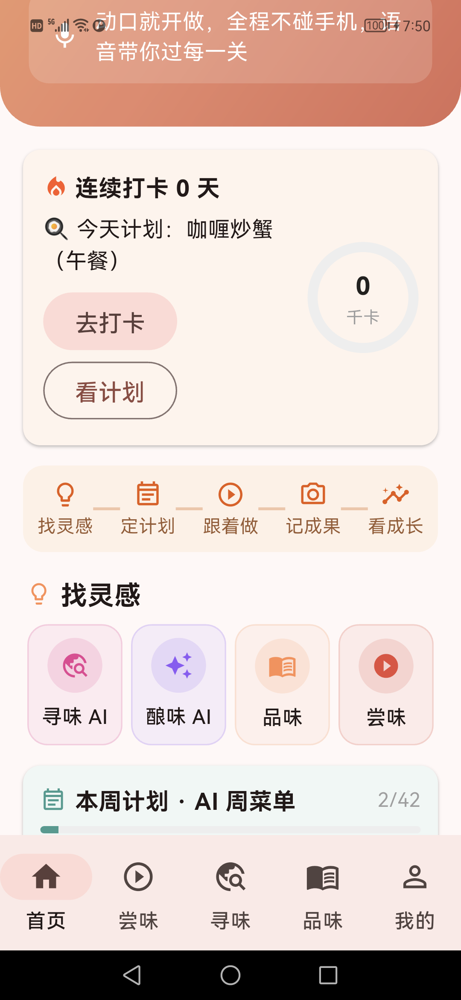 | 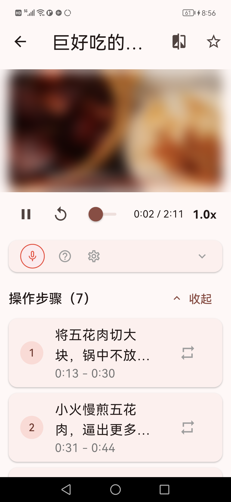 | 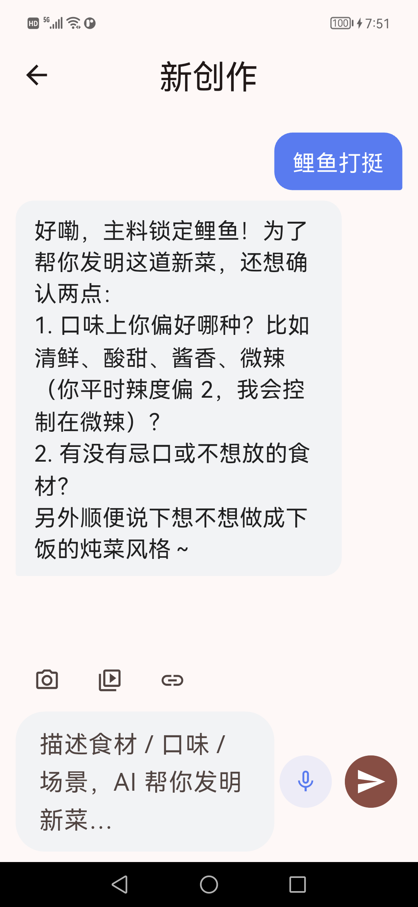 | 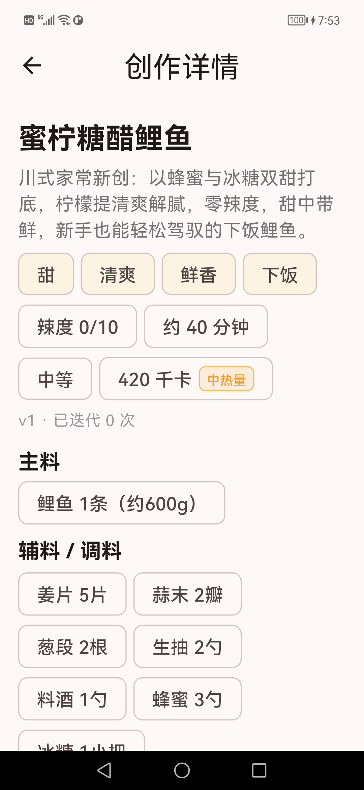 |

| AI 视频教程 / 酱汁 / 效果图 | 过敏原与食物安全提示 | 品味库 · 工业级精确 | 寻味记忆 · 偏好自进化 |
|---|---|---|---|
| 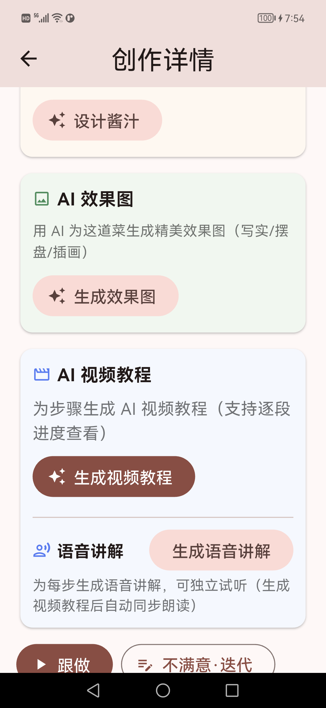 | 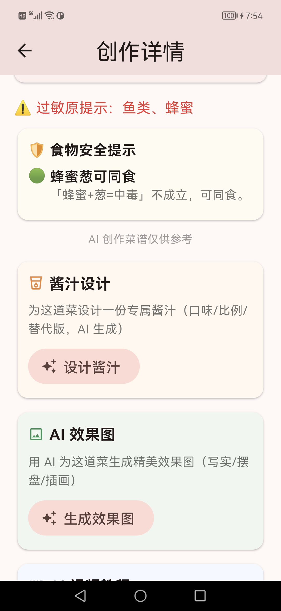 | 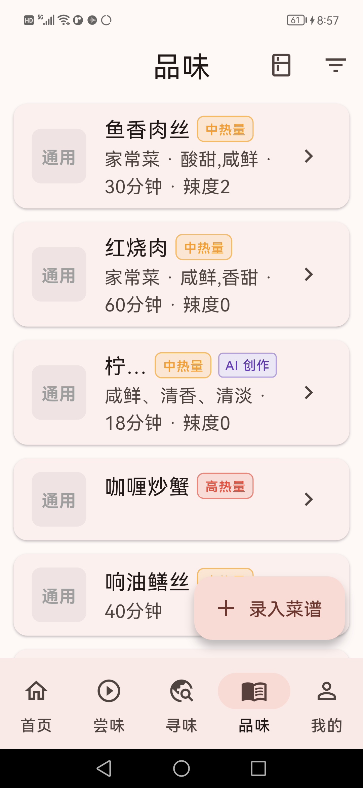 | 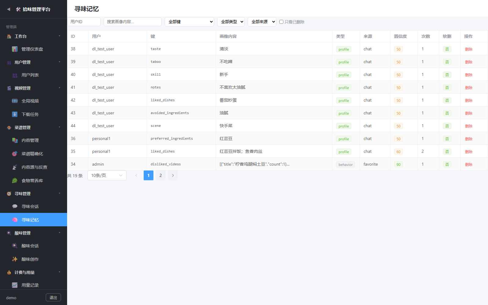 |

### Web 管理端

| 管理仪表盘 | AI 引擎配置中心 | 厨电设备控制 |
|---|---|---|
| 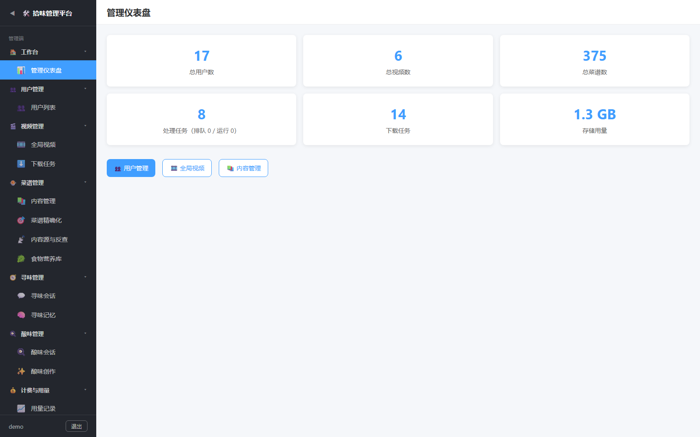 | 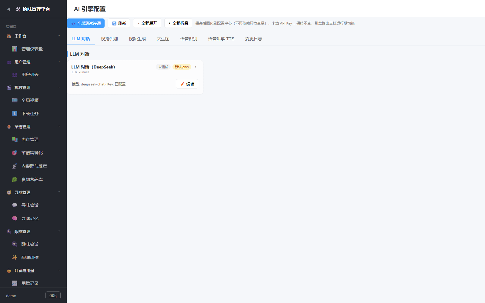 | 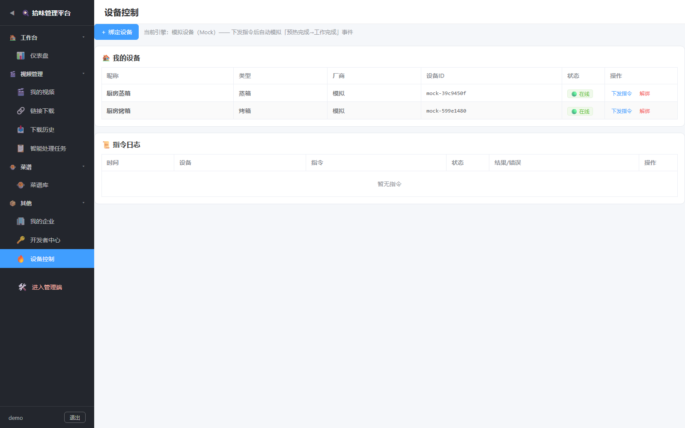 |

---

## 它解决什么问题

| 厨房里的烦恼 | 拾味的回答 |
|---|---|
| **站在冰箱前发呆**：晚饭吃什么？最后还是点了外卖 | 说一句"家里有鸡腿和土豆，做道什么好"——**寻味 AI** 立刻给答案；不想描述就直接**拍一张冰箱/食材照片** |
| **照着教程做还是翻车**："盐适量""中火焖一会儿"，成品差出十万八千里 | 把每道菜做到**"工业级精确"**：盐 3.5 克±0.5 克、烤箱 200℃、焖 8 分钟±30 秒 |
| **做饭时手忙脚乱**：满手是油，不敢碰手机 | 动嘴就行：**"下一步""暂停""回放一下""2 倍速"**，语音指令全程控制 |
| **做完了不知道好不好**：总觉得差点意思，说不清差在哪 | **拍照给拾味看**，从**色泽、火候、收汁、摆盘、完成度**五个维度告诉你差在哪、怎么改 |
| **吃归吃，健康全靠猜**：减脂没效果、慢病饮食不清 | 记住你的**健康档案、忌口、过敏原、正在服用的药物**，做之前就**提前提醒**，做完自动记营养、月底出报告 |

> **不会做饭不是你的问题，是缺一位好老师。** 这五类烦恼，就是拾味存在的理由。

---

## 四大核心能力

### 寻味 · 不知道吃什么？问它就知道了

- **对话式找菜**："今晚想吃点清淡的""有没有 15 分钟能做完的？"——听得懂自然语言，还会追问口味；
- **拍照识菜**：拍一张食材照片（Qwen-VL 视觉识别），推荐"刚好用得上"的菜，不浪费冰箱里任何一样东西；
- **食材反查**：输入"手头有什么"，反查能做的菜，支持"缺一匹配"（少一两样配料也能给方案）；
- **越用越懂你**：记住你的口味偏好、忌口与历史行为，推荐越来越合胃口，甚至会提醒"这道菜偏辣，你确定要试吗？"。

### 酿味 · 发明一道世界上还没有的菜

- **对话式共创**："家里有鸡腿和土豆，帮我想道新菜，不要太辣，20 分钟搞定"——多轮追问、确认，把想法"聊"成一道新菜（见[界面预览](#界面预览)「多轮共创」）；
- **AI 视频教程**：为每一步生成真实画面，拼接成一条完整、可跳转、可循环的视频教程，并配语音讲解（Qwen3-TTS）；
- **不满意就改**：不够辣、分量少、步骤复杂？带反馈重新生成，改到满意为止；
- **酱汁设计与效果图**：生成结构化酱汁配方（配比/步骤/替代方案），并一键生成成品效果图；
- **安全兜底**：生成前自动核对过敏原与忌口，命中风险直接拦截或要求确认。

### 尝味 · 跟着做，不翻车

- **视频步骤定位**：任何做菜视频都拆解成可跳转、可循环、可调速的步骤卡，**每一步精确到秒**（见[界面预览](#界面预览)「步骤定位」）；
- **语音控制**：11 种语音指令——"下一步""暂停""循环这一步""2 倍速"，手再脏也能控制；
- **成品拍照纠偏**：五维诊断（色泽/火候/收汁/摆盘/完成度）给出"哪里好、差在哪、怎么改"；
- **分量换算**：2 人份改 5 人份，食材用量自动调整；
- **离线可用**：视频可下载到本地（HLS 切流合并），没网也能跟着做。

### 懂味 · 吃得明白，吃得放心

- **健康档案**：录入身高体重、年龄与目标（减脂/增肌/保持），自动算出每日热量与蛋白质目标；
- **尝味即记录**：做完一道菜，营养数据自动记入当天饮食，不用手动记账；
- **AI 饮食复盘**：结合健康档案与饮食记录，给出看得懂的分析与建议；体重趋势与目标联动；
- **拍照打卡**：拍一张饭桌照，识别菜品 + 估算份量，自动换算营养写入记录；
- **食品安全知识库**：食物与药物相互作用、加工安全红线、个体过敏、营养素吸收干扰；对"食物相克"类谣言以权威共识辟谣（见[界面预览](#界面预览)「安全提示」）。

---

## 一次完整的使用旅程

```
① 打开拾味，拍一张冰箱里的食材照片
        │
        ▼
② 寻味 AI 推荐 3 道"刚好用得上"的菜
        │   （说"换个不辣的"，它立刻调整）
        ▼
③ 选中一道，AI 视频教程自动播放
        │   （步骤卡随视频高亮，说"下一步"就跳转）
        ▼
④ 跟着做完，拍一张成品照
        │   （AI 给出"差在哪、怎么改"的五维诊断）
        ▼
⑤ 打卡记录这一餐
        │   （营养自动记入健康档案，对比你的营养目标）
        ▼
⑥ 月底，拾味给你一份"这个月吃得怎么样"的报告
        ▼
⑦ 想换个花样？让酿味 AI 用你冰箱里的食材发明一道新菜
        ▼
⑧ 如此往复——拾味越来越懂你，你越做越好
```

---

## 功能特性

**视频步骤定位（核心）**

- 视频分片上传 / 断点续传 / MD5 秒传
- 自动调度 Python AI 流水线（FFmpeg → WhisperX → LLM 步骤抽取 → 三级时间戳映射）
- 步骤级定位与跳转、步骤循环播放、倍速控制
- WebSocket 实时推送处理进度
- 视频分享链接与权限管理（公开 / 私有 / 指定用户）
- HLS（m3u8）本地下载：移动端解析 master 清单选流 + FFmpeg 合并，支持断点与去重

**语音控制**

- 双 ASR 引擎可切换：**FunASR（本地，MIT）** / **阿里云 NLS（云端）** / `auto` 自动降级
- 规则优先 + LLM 兜底语义分类，支持「暂停 / 继续 / 下一步 / 重播 / 跳到第 N 步」等指令
- 前端 VAD 与自动闪避（ducking）策略

**内容与运营（Web 管理端）**

- 视频审核发布流程、内容源管理（开源菜谱库同步）
- 用户与角色管理、企业账号、配额与计费配置
- AI 模型配置中心：多供应商 / 多模型可视化配置，密钥加密落库（AES-GCM），运行期热切换
- 菜谱来源体系与工业级精确化、食材反查、食物安全提醒知识库
- 回收站软删除与超期自动清理

**移动端（Android）**

- 视频播放 + 步骤时间轴交互、离线缓存与本地优先播放
- 手机端视频链接解析下载（yt-dlp / HLS）
- 扫码下载 APK、拍照打卡、做饭计划执行闭环、成长体系

**AI 创作与扩展（可选模块）**

- 「寻味」：文本对话与拍照识别食材（Qwen-VL）
- 菜品创作：菜谱生成、酱汁设计、效果图（通义万相）、语音讲解（Qwen3-TTS）、步骤视频生成
- 营养健康模块、食材反查、智能厨电中控

---

## 系统架构

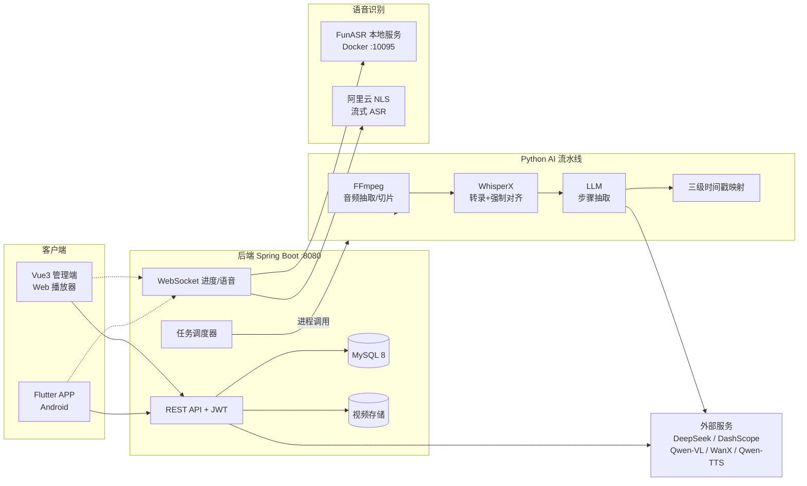

处理链路：

```
视频文件 ──FFmpeg──▶ 音频 ──WhisperX──▶ 转录+词级时间戳
                                          │
                                          ▼
                                   LLM 步骤结构化抽取
                                          │
                                          ▼
                             三级时间戳映射（精确 / 模糊 / 兜底）
                                          │
                                          ▼
                                    steps.json ──▶ 播放器步骤跳转
```

---

## 技术栈

| 层 | 技术 |
|---|---|
| 后端 | Java 17、Spring Boot 3.2、Spring Security、WebSocket、MyBatis-Plus 3.5、MySQL 8、JJWT、springdoc-openapi |
| Web 管理端 | Vue 3、Vite 5、Pinia、Vue Router、Element Plus、video.js、axios |
| 移动端 | Flutter 3、Dart、Provider、dio、video_player、record、ffmpeg_kit_flutter、flutter_hls_parser |
| AI 流水线 | Python 3.10–3.12、WhisperX、faster-whisper、CTranslate2、PyTorch、FFmpeg、OpenAI SDK（兼容 DeepSeek） |
| 语音识别 | FunASR（本地 Docker）、阿里云智能语音交互 NLS |
| 部署 | Windows 11（一键批处理 + Maven/Node 构建）、Docker Desktop（本地语音服务） |

---

## 目录结构

```
.
├── video-step-locator-backend/     # Spring Boot 后端（REST + WebSocket + 调度）
│   ├── src/main/java/com/videostep/locator/
│   ├── src/main/resources/application.yml
│   └── src/main/resources/db/init.sql
├── video-step-locator-web/         # Vue 3 管理端（Vite）
│   └── src/{api,views,stores,composables,...}
├── video-step-locator-app/         # Flutter 移动端（Android 平台工程已就绪）
│   ├── lib/{pages,services,providers,models,widgets}
│   ├── android/
│   └── assets/logo.png
├── video-step-locator/             # Python AI 流水线
│   ├── scripts/{extract_audio,transcribe,extract_steps,match_timestamps,pipeline}.py
│   ├── frontend/                   # 流水线本地演示页
│   └── requirements.txt
├── deploy/                         # 部署脚本与配置
│   ├── scripts/                    # Windows 一键部署（01~05）
│   ├── backend/                    # 后端配置模板
│   └── ubuntu/                     # 备选：Linux 部署参考（本说明未展开）
├── assets/screenshots/             # README 界面图
├── .env.example
├── logo.png
├── NOTICE.md
└── README.md
```

---

## 快速开始（Windows 11）

> 本节命令均在 **Windows 11 + PowerShell** 下验证。默认使用 `PowerShell`，涉及 `.bat` 的脚本可直接双击或在 CMD 中运行。

### 环境要求

| 组件 | 版本 | 必需 | 用途 |
|---|---|---|---|
| JDK | 17+ | ✅ | 后端运行 |
| Maven | 3.8+ | ✅ | 后端构建 |
| MySQL | 8.0+ | ✅ | 数据存储 |
| Python | 3.10 – 3.12（⚠️ 不支持 3.13+，WhisperX 兼容性） | ✅ | AI 处理流水线 |
| FFmpeg | 4.4+ | ✅ | 音视频处理 |
| Node.js | 18+ | 构建/开发管理端时 | Web 前端 |
| Flutter | 3.2+（Android 构建需 JDK 17） | 构建 APP 时 | 移动端 |
| yt-dlp | 最新版 | 使用链接解析下载时 | 视频解析 |
| NVIDIA GPU + CUDA | 显存 ≥ 6 GB | 可选 | 加速 AI 流水线 |
| Docker Desktop | 最新版 | 可选 | 本地 FunASR 语音服务 |

### 第 0 步：安装依赖

Windows 11 自带 `winget`，可一条命令装齐：

```powershell
winget install EclipseAdoptium.Temurin.17.JDK
winget install Apache.Maven
winget install Oracle.MySQL
winget install Python.Python.3.12
winget install Gyan.FFmpeg
winget install OpenJS.NodeJS.LTS
winget install yt-dlp.yt-dlp
```

> 若提示找不到 `winget`，先在 Microsoft Store 中更新「应用安装程序」。
> 安装后请**重新打开**一个 PowerShell 窗口，使 `PATH` 生效。

验证安装：

```powershell
java -version      # 应显示 17.x 或以上
mvn -v             # 应显示 Apache Maven 3.8+
mysql --version    # 应显示 8.0+
python --version   # 应为 3.10 ~ 3.12
ffmpeg -version    # 应显示 FFmpeg 版本
node -v            # 应为 v18+
yt-dlp --version   # 可选
```

### 第 1 步：初始化数据库

```powershell
mysql -u root -p -e "CREATE DATABASE video_step_locator DEFAULT CHARACTER SET utf8mb4 COLLATE utf8mb4_unicode_ci;"
```

导入建表脚本（⚠️ **Windows PowerShell 不支持 `<` 输入重定向**，请用下面任一方式）：

```powershell
# 方式一：交给 cmd 执行重定向
cmd /c "mysql -u root -p video_step_locator < video-step-locator-backend\src\main\resources\db\init.sql"

# 方式二：用管道
Get-Content .\video-step-locator-backend\src\main\resources\db\init.sql | mysql -u root -p video_step_locator
```

### 第 2 步：准备 AI 处理流水线（Python）

```powershell
cd video-step-locator
python -m venv .venv
.\.venv\Scripts\Activate.ps1

# 若报「禁止运行脚本」，先临时放开当前会话的执行策略
# Set-ExecutionPolicy -Scope Process -ExecutionPolicy Bypass

pip install -r requirements.txt
Copy-Item .env.example .env
notepad .env          # 填入 LLM_API_KEY 等配置
```

单条视频离线处理：

```powershell
python scripts\pipeline.py `
  --input input\cooking.mp4 `
  --output output `
  --whisper-model tiny `
  --device cpu `
  --llm-api-key $env:LLM_API_KEY `
  --llm-base-url https://api.deepseek.com/v1 `
  --llm-model deepseek-chat
```

> **模型下载慢**：首次运行会从 HuggingFace 下载 Whisper 权重，国内建议先设置镜像
> `$env:HF_ENDPOINT = "https://hf-mirror.com"`（也可写入 `.env` 持久化）。
> **GPU 加速**：安装 CUDA 版 PyTorch 后，把 `.env` 中的 `PROCESSING_DEVICE` 改为 `cuda`。

### 第 3 步：构建并启动后端

```powershell
cd video-step-locator-backend
mvn clean package -DskipTests
```

设置必要环境变量并启动（**至少配置前 3 项**）：

```powershell
$env:MYSQL_PASSWORD = "<你的数据库密码>"
$env:JWT_SECRET     = "<256bit 以上随机串>"
$env:LLM_API_KEY    = "<你的 DeepSeek API Key>"

# 指向本机路径（按实际解压位置调整）
$env:PIPELINE_DIR        = "D:\shihui\video-step-locator"
$env:VIDEO_STORAGE_PATH  = "D:\shihui\data\videos"

java -jar target\video-step-locator-backend-1.0.0.jar
```

后端默认监听 `http://localhost:8080`。

> **想持久化环境变量**（新开窗口仍生效）：使用 `setx`，例如
> `setx JWT_SECRET "<256bit 以上随机串>"`，设置后需重开终端。
> **后台运行**：`Start-Process java -ArgumentList '-Xmx512m','-jar','target\video-step-locator-backend-1.0.0.jar' -WindowStyle Hidden`
> **一体化打包**（后端直接托管管理端页面）：先 `cd video-step-locator-web && npm install && npm run build`，把 `dist\*` 复制到 `video-step-locator-backend\src\main\resources\static\`，再重新 `mvn package`。

### 第 4 步：启动 Web 管理端

```powershell
cd video-step-locator-web
npm install
npm run dev          # 打开 http://localhost:3000（/api、/ws 已代理到 :8080）
```

生产构建与部署：`npm run build` 生成 `dist\`，可交由 Nginx/IIS 托管，或按上面的方式打进后端 JAR。

### 第 5 步：构建移动客户端（Android，可选）

```powershell
cd video-step-locator-app
flutter pub get
flutter run --dart-define=API_BASE=http://10.0.2.2:8080/api        # Android 模拟器
```

真机联调（`10.0.2.2` 仅对模拟器有效，真机需用电脑局域网 IP）：

```powershell
ipconfig                                                            # 查看本机 IPv4 地址
flutter build apk --release --dart-define=API_BASE=http://192.168.x.x:8080/api
adb install -r build\app\outputs\flutter-apk\app-release.apk
```

> **真机连不上后端**：Windows 防火墙默认拦截入站 8080，请以**管理员身份**执行
> `New-NetFirewallRule -DisplayName "拾味后端8080" -Direction Inbound -LocalPort 8080 -Protocol TCP -Action Allow`
> 并确认手机与电脑在同一 Wi-Fi、后端监听地址可被局域网访问。

### 第 6 步：一键部署脚本（Windows）

`deploy\scripts\` 下提供按序执行的批处理脚本（建议以管理员身份运行第 1 个）：

| 脚本 | 作用 |
|---|---|
| `01-setup-env.bat` | 检查依赖、创建虚拟环境、初始化存储目录 |
| `02-build.bat` | 构建 Web 前端与后端 JAR |
| `03-start.bat` | 交互式输入必要配置后启动服务 |
| `04-stop.bat` | 停止服务 |
| `05-status.bat` | 查看运行状态与端口占用 |
| `check_port.bat` | 检查端口占用情况 |

### 第 7 步：本地语音识别（可选）

不配置时语音识别会自动走云端或降级为规则匹配；如需**本地免费**识别，用 Docker Desktop 启动 FunASR：

```powershell
docker compose -f deploy\ubuntu\docker-compose.funasr.yml up -d
# 默认 WebSocket :10095 / HTTP :10096（后端默认连接 localhost:10096）
```

> 该 compose 文件位于 `deploy\ubuntu\` 目录，在 Windows 上通过 Docker Desktop 同样可用。

### Windows 常见问题

| 现象 | 原因 | 解决 |
|---|---|---|
| 后端启动后端口不是 8080 | dev 配置或参数缺省导致随机端口 | 启动命令加 `--server.port=8080` |
| `mysql < xxx.sql` 报语法错误 | PowerShell 不支持 `<` 重定向 | 用 `cmd /c "..."` 或 `Get-Content ... \| mysql` |
| `.venv\Scripts\Activate.ps1` 无法加载 | PowerShell 执行策略限制 | `Set-ExecutionPolicy -Scope Process -ExecutionPolicy Bypass` |
| `ffmpeg` 不是内部或外部命令 | FFmpeg 未加入 PATH | 重新打开终端，或设置 `FFMPEG_PATH` 指向绝对路径 |
| `npm install` 缓慢/失败 | 默认源网络受限 | `npm config set registry https://registry.npmmirror.com` |
| Whisper 权重下载超时 | HuggingFace 访问受限 | `$env:HF_ENDPOINT = "https://hf-mirror.com"` |
| Flutter 构建报 JDK 版本错误 | Gradle 使用了非 17 的 JDK | `flutter config --jdk-dir "<JDK17 路径>"` |
| 前端报 `safe-delete` 相关错误 | Vite 依赖缓存被安全策略拦截 | 删除 `node_modules\.vite` 后重启 |
| AI 功能无响应 | 未配置对应 API Key | 配置 `LLM_API_KEY` / `ALIYUN_ASR_APP_KEY` |
| 语音控制不生效 | 未授权麦克风 / FunASR 未启动 | 授权麦克风；启动 FunASR 或切换云端 ASR |

---

## 配置说明

### 环境变量一览

| 变量 | 说明 | 默认值 |
|---|---|---|
| `MYSQL_PASSWORD` | MySQL 密码 | `root`（⚠️ 生产必须修改） |
| `JWT_SECRET` | JWT 签名密钥（HS256 需 ≥256bit） | 示例值（⚠️ 生产必须修改） |
| `LLM_API_KEY` | DeepSeek 兼容 API Key | 空 |
| `LLM_BASE_URL` | LLM 接口地址 | `https://api.deepseek.com/v1` |
| `LLM_MODEL` | 模型名 | `deepseek-chat` |
| `DASHSCOPE_API_KEY` / `ALIYUN_ASR_APP_KEY` | 阿里云百炼（DashScope）Key，用于拍照识菜 / 语音讲解 / 文生图；`ALIYUN_ASR_APP_KEY` 为历史变量名，实际承载 DashScope Key | 空 |
| `SEEDANCE_API_KEY` | 火山方舟 Seedance 视频生成（可选） | 空 |
| `VIDEO_STORAGE_PATH` | 视频存储根目录 | `./data/video-steps` |
| `PIPELINE_DIR` | Python 流水线目录 | `../video-step-locator` |
| `PYTHON_PATH` | Python 可执行文件 | `python` |
| `FFMPEG_PATH` | FFmpeg 可执行文件 | `ffmpeg` |
| `YTDLP_PATH` | yt-dlp 可执行文件 | `yt-dlp` |
| `PROCESSING_DEVICE` | `cpu` / `cuda` | `cpu` |
| `APK_DIR` | APK 存放目录 | `data/apk` |
| `HOWTOCOOK_REPO` / `HOWTOCOOK_DIR` | 开源菜谱内容源仓库与本地目录 | `https://github.com/Anduin2017/HowToCook.git` / `data/howtocook` |
| `RECIPE_PRECISION_THRESHOLD` | 工业级菜谱派生阈值 | `0.7` |
| `RECYCLE_RETENTION_DAYS` | 回收站保留天数 | `90` |
| `HEALTH_FOOD_DB_INIT` / `SAFETY_RULES_INIT` | 启动初始化营养库 / 安全规则库 | `true` |
| `TUYA_CLIENT_ID` / `TUYA_CLIENT_SECRET` / `MIJIA_CLIENT_ID` / `MIJIA_CLIENT_SECRET` | 智能厨电中控（配置项已预留；模拟链路可演示，真机接入按设备型号联调） | 空 |

完整配置项见 `video-step-locator-backend/src/main/resources/application.yml`（每项均支持环境变量覆盖，勿把密钥写入配置文件）。

### 密钥安全约定

- 仓库内**不保存任何真实密钥**；所有密钥通过环境变量注入（开发用 `.env`，生产用系统环境变量或服务配置，权限最小化）。
- AI 模型配置中心写入数据库的密钥使用 **AES-GCM** 加密（主钥落地于 `ai_config_settings`，属纵深防御，不防"能读库的人"）。
- 健康数据等敏感字段使用独立密钥域（`SAFETY_CIPHER_KEY`），与 AI 配置隔离。
- 若曾将密钥提交到版本库，请立即在服务商控制台**吊销并轮换**。

---

## 核心实现说明

### 三级时间戳映射

LLM 抽取的步骤文本与 WhisperX 词级时间戳之间存在表述差异，因此采用三级匹配策略：

1. **精确匹配**：步骤文本与转录片段归一化后直接命中；
2. **模糊匹配**：编辑距离 / 关键词重合度达到阈值；
3. **兜底**：按步骤序数在时间轴上等分或顺延。

映射结果写入 `output/steps/*.json`，供播放器按步骤跳转。

### 语音控制语义分类

「规则优先 + LLM 兜底」：先由规则引擎匹配高频指令（同义词表 + 中文数字解析），未命中时调用 LLM 做意图分类（超时 2s），并将结果映射为播放器动作。ASR 不可用时自动降级为纯规则模式，保证可用性。

### AI 视频教程的时间戳

AI 生成的视频是**分段生成**的，每段时长不同。拼接时按段累计时长，天然得到各步骤的时间戳，因此步骤卡与画面始终对得上——这是 AI 视频相对真实视频的结构性优势。

### AI 模型配置中心

支持多供应商（DeepSeek / DashScope 等）、多类型（文本、视觉、ASR、TTS、文生图、文生视频）的可视化配置与热刷新；配置变更后通过 refreshable bean 生效，无需重启（见[界面预览](#界面预览)「AI 引擎配置中心」）。

---

## 面向厨具企业与生态

对厨具企业，「拾味」是一套**内容 + 设备 + 数据**的数字厨房软件基座：把完整 AI 烹饪能力封装为**可白标、可授权、可开放、可订阅**的合作形态，让设备出厂即自带一位"会教做菜、会记口味"的 AI 老师。

| 厂商常见困境 | 对应的工程能力 |
|---|---|
| 设备"买前惊艳、买后吃灰" | 步骤化教学视频内容库 + 开源内容源导入 + AI 创作持续供给，让设备每天都有新菜可做 |
| 自建内容生态成本高 | 工业化品味生产链路：视频/图文自动产出结构化精确品味（四源统一品味模型 + 溯源体系） |
| 产品同质化、溢价弱 | 全语音交互、成品纠偏、营养健康闭环、厨电协同，构建体验差异 |
| 用户关系止于交付 | 内容持续更新 + 成长闭环 + 健康陪伴，把一次性交易变成持续服务 |
| 设备数据沉睡 | 偏好画像引擎 + 设备事件流 + 平台数据看板 |

**已具备的对接形态（代码层面）**

- **开放平台 API**：企业级 `appKey/appSecret` + HMAC-SHA256 签名认证、访问限流、调用计量与配额；
- **多租户与角色**：企业账号体系（owner / admin / operator / member 四级角色）+ 内容配额与数据隔离；
- **白标能力**：品牌名称、Logo、主题色等可配置（Web 端已实现）；
- **厨电协同**：品味参数自动提取（温度/模式/时长）→ 一键下发 → 设备状态回传的完整链路，含模拟设备网关；真机接入按设备型号联调（主流 IoT 平台适配能力已就绪）；
- **服务端 AI 配置中心**：多供应商 / 多类型（文本、视觉、ASR、TTS、文生图、文生视频）热配置，无需重启。

> 本仓库只包含上述能力的**工程实现**，不含任何商业授权、内容资产或商务条款；企业合作事宜请通过项目权利人渠道另行沟通。

---

## 数据与能力成熟度

> 以下产品侧指标来自产品白皮书实测记录，用于说明工程规模；本仓库**不随附这些内容数据**（内容库由开源内容源同步 + 产品侧生产，见 `NOTICE.md`）。

| 指标 | 数据 |
|---|---|
| 品味内容库 | 374 道，其中 356 道达到"工业级精确"标准 |
| 开源内容源结构化导入 | 369 道（如 HowToCook，逐道可溯源） |
| 食材标签索引 | 758 个（支撑"手头有什么 → 能做什么"反查） |
| 食物营养库 | 363 种（163 种人工核对 + 200 种 AI 估算回填） |
| 语音指令 | 11 种（步骤跳转、播放控制、倍速等） |
| 工业级精确标准 | 用量到克、火候到 ℃、时间到分钟，含误差范围与分量换算 |

**能力成熟度（透明标注）**

| 能力域 | 具体能力 | 成熟度 |
|---|---|---|
| 内容生态 | 视频 → 结构化品味流水线、图文链接 → 结构化品味、四源统一品味模型 + 溯源 | 已实现 |
| AI 教学 | 步骤级视频定位与交互播放、全语音控制（双引擎自动切换） | 已实现 |
| AI 教学 | 成品拍照纠偏（五维报告 + 偏差画像） | 已实现 |
| AI 创作 | 多轮共创 + 多源融合、AI 视频教程生成、AI 语音讲解、酱汁配方 + 效果图 | 已实现 |
| 营养健康 | 营养计算 / 尝味即记录 / AI 复盘 / 拍照打卡 / 食物安全知识库 | 已实现 |
| 用户运营 | 偏好自进化记忆 + 成长闭环（打卡、等级、徽章、月度报告） | 已实现 |
| 平台底座 | 企业账号 / 配额 / 计费 / 账单闭环、开放平台 API、白标（Web 已实现） | 已实现 |
| 厨电协同 | 参数提取 + 一键下发 + 状态回传（模拟链路全流程） | 已实现可演示 |
| 厨电协同 | 主流 IoT 平台真机接入（涂鸦 / 米家等） | 接入能力就绪，真机按型号联调 |

---

## 接口与运行时文档

- Swagger UI（运行时自动生成）：`http://localhost:8080/swagger-ui.html`
- OpenAPI JSON：`http://localhost:8080/v3/api-docs`
- 企业开放平台接口采用 HMAC-SHA256 签名：`X-Signature = hex(HMAC-SHA256(appSecret, appKey + timestamp + nonce + body))`，时间戳窗口 5 分钟，限流 60 次/分钟。

> 说明：本仓库仅包含源码与运行必需的模板文件；内部技术设计、测试、交接与商务类文档不随代码开源。

---

## 第三方引用与声明

本项目大量受益于开源社区，完整的依赖清单、许可协议与引用说明见 **[NOTICE.md](NOTICE.md)**。核心引用如下：

| 项目 | 用途 | 许可 |
|---|---|---|
| [FunASR](https://github.com/modelscope/FunASR)（阿里达摩院） | 本地语音识别（Docker Runtime + WebSocket 客户端） | MIT |
| [WhisperX](https://github.com/m-bain/whisperX) | 语音转录与词级强制对齐 | BSD-2-Clause |
| [faster-whisper](https://github.com/SYSTRAN/faster-whisper) / [CTranslate2](https://github.com/OpenNMT/CTranslate2) | 推理后端 | MIT |
| [OpenAI Whisper](https://github.com/openai/whisper) | 语音识别模型与权重（运行时下载，不随仓库分发） | MIT |
| [HowToCook](https://github.com/Anduin2017/HowToCook) | 开源菜谱内容源（运行时同步，不随仓库分发） | Unlicense |
| [yt-dlp](https://github.com/yt-dlp/yt-dlp) | 视频链接解析与下载（需自行安装） | Unlicense |
| [FFmpeg](https://ffmpeg.org/) | 音频抽取、切片、合并、HLS（需自行安装，不随仓库分发） | LGPL-2.1+ / GPL |
| [FFmpegKit](https://github.com/arthenica/ffmpeg-kit)（`ffmpeg_kit_flutter_new_https`） | 移动端本地下载与合并 | LGPL-3.0 |
| Spring Boot、MyBatis-Plus、Vue 3、Vite、Element Plus、Flutter 等 | 框架与组件 | Apache-2.0 / MIT / BSD-3-Clause |

**外部服务**：DeepSeek、阿里云百炼（DashScope：Qwen-VL / Qwen-TTS / 通义万相 Wan）、阿里云智能语音交互、火山方舟 Seedance。上述服务均为第三方商业 API，**本项目不包含其任何密钥或授权**，使用者需自行申请并按各自服务条款使用。

**界面图说明**：`assets/screenshots/` 中的截图取自本软件真实运行界面，用于功能说明；其中演示视频画面已做模糊处理，涉及第三方内容与个人信息的界面未纳入开源范围。

---

## 商标与免责声明

1. **品牌**：产品名「**拾味**」及仓库内 Logo、图标已随本项目公开，可基于学习与研究目的使用；但不得以本项目或权利人名义进行商业宣传、暗示官方背书，亦不得将「拾味」直接作为衍生产品的品牌名称使用。
2. **内容与数据**：产品侧内容库（品味、营养库、安全规则库等）与白皮书数据**不随本仓库分发**；仓库中引用的开源内容源（如 HowToCook）遵循其各自许可，署名见 [NOTICE.md](NOTICE.md)。
3. **合规使用**：视频下载相关功能仅供**个人学习与研究**使用，请遵守目标平台的用户协议与所在地区法律法规，不得用于绕过版权保护或批量抓取。
4. **AI 输出**：菜谱步骤、营养估算、食物安全提醒等均为模型自动生成，可能存在错误，**不构成医疗、营养或食品安全建议**，请自行判断并对实际烹饪行为负责。
5. **外部服务条款**：使用 DeepSeek / 阿里云等服务时，须遵守对应服务商的条款与配额限制，相关费用由使用者承担。
6. **无担保**：本软件按「现状」提供，不附带任何明示或默示担保。

---

## 贡献与安全

- 欢迎提交 Issue 与 Pull Request；提交前请确保**不包含任何真实密钥、内部域名、日志文件或个人路径**。
- 安全漏洞请勿公开提交 Issue，通过私下反馈。

## 许可协议

本项目开源许可协议**待权利人确定后补充**。
在正式发布许可协议前，请勿将本仓库代码用于任何商业用途或再分发。
